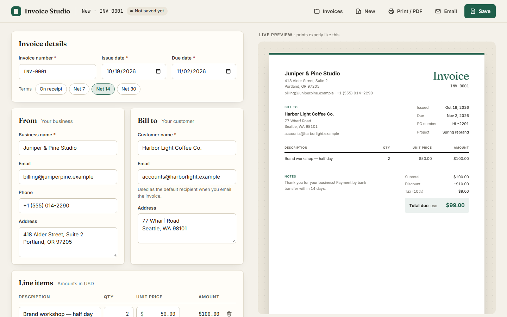

# Invoice Studio

A browser-based invoice generator for a small business: edit an invoice with a live, print-ready preview, add custom fields, save invoices to a database and email them through SMTP.

Built with **plain PHP 8.3 + SQLite/MySQL** on the backend and **vanilla JavaScript (ES modules) + CSS** on the frontend. There are no frameworks, no Composer packages and no build step.



---

## Features

| Brief requirement | Where / how |
|---|---|
| Invoice editor (business, customer, number, issue/due dates, notes) | Left-hand editor. Includes "Net 7 / 14 / 30" shortcuts for the due date. |
| Line items: add, edit, remove (description, qty, unit price) | Pressing **Enter** on the last line adds a new one. Each line shows its own total. |
| USD totals: line totals, subtotal, fixed discount, % tax, grand total | Integer-cent math, identical in the browser and on the server (see [How totals are calculated](#how-totals-are-calculated)). |
| Custom fields: add, edit, hide/show, remove | Visible fields appear in the invoice's meta block. Hidden ones are kept but never rendered, printed or emailed. They never affect totals. |
| Live preview + PDF | The preview re-renders on every keystroke. **Print / PDF** uses the browser's print dialog, and the print stylesheet outputs only the invoice. |
| Responsive, accessible | Desktop two-column layout. On mobile there are Edit/Preview tabs and a bottom action bar. Real `<label>`s, keyboard access, visible focus, AA contrast, inline and summary validation. |
| Backend: save and retrieve | JSON API + SQLite (default) or MySQL. Each saved invoice gets its own URL (`#/invoice/12`), so a reload brings it back. |
| Email | Sends a formatted HTML + plain-text email through any SMTP provider. A `log` mode writes `.eml` files when no SMTP is configured. |
| Validation | Quantities, prices, discounts and tax rates can't be negative. The discount can't exceed the subtotal. Enforced in the UI **and** on the server. |
| Check: 2 × $50 − $10 + 10% tax = **$99.00** | The demo invoice shown on first launch is exactly this case. It's also covered by automated tests. |

Small extras: an unsaved-changes indicator with a leave-page warning, **Ctrl/⌘+S** to save, five accent colours for the invoice, new invoices that reuse your business details and the next invoice number, unique invoice numbers, and an email history per invoice.

---

## Quick start

Requirements: **PHP 8.1+** with `pdo_sqlite` (or `pdo_mysql`) and `openssl`. No Composer or Node.js is needed.

```bash
git clone <this-repo> invoice-studio
cd invoice-studio
cp .env.example .env          # defaults work as-is: SQLite + "log" email mode
php -S 127.0.0.1:8000 -t public public/index.php
```

Open <http://127.0.0.1:8000>. The database file `storage/database.sqlite` and its tables are created automatically on the first request.

### Running under nginx / Apache (e.g. OSPanel, XAMPP, a VPS)

Point the site's **document root at `public/`**, not at the project root, so that `src/`, `storage/` and `.env` are never web-accessible.

- **nginx**: `try_files $uri $uri/ /index.php?$query_string;`
- **Apache**: `public/.htaccess` already rewrites unknown paths to `index.php` (`mod_rewrite` must be enabled).

---

## Configuration (`.env`)

All configuration lives in `.env`, which is git-ignored. `.env.example` lists every option with placeholders. Real environment variables take precedence over the file.

### Storage

| Variable | Default | Notes |
|---|---|---|
| `DB_CONNECTION` | `sqlite` | `sqlite` or `mysql` |
| `DB_DATABASE` | `storage/database.sqlite` | SQLite: file path (relative to the project root). MySQL: database name. |
| `DB_HOST`, `DB_PORT`, `DB_USERNAME`, `DB_PASSWORD` | – | MySQL / MariaDB only. Create an empty database; the tables are created automatically. |

Schema: an `invoices` table (indexed columns for the list view plus the full invoice as JSON) and an `email_log` table. See `src/Database.php`.

### Email

| Variable | Example | Notes |
|---|---|---|
| `MAIL_DRIVER` | `log` / `smtp` | `log` writes emails to `storage/mail/*.eml` (open them in any mail client). |
| `MAIL_FROM_ADDRESS` | `invoices@your-domain.test` | Must be a sender your SMTP provider allows. |
| `MAIL_FROM_NAME` | `Invoice Studio` | Fallback only. Emails are sent "from" the invoice's business name. |
| `SMTP_HOST`, `SMTP_PORT` | `smtp.example.com`, `587` | |
| `SMTP_ENCRYPTION` | `tls` | `tls` = STARTTLS (usually port 587), `ssl` = implicit TLS (465), `none` for local catchers. |
| `SMTP_USERNAME`, `SMTP_PASSWORD` | | Read only on the server. Never sent to the browser. |
| `SMTP_CA_FILE` | | Optional CA bundle path if PHP can't verify certificates (sometimes needed on Windows). |
| `MAIL_ALLOWED_RECIPIENTS` | `me@example.com,@mycompany.test` | Optional safety net: the server refuses any other recipient. Useful while testing. |

Provider examples:

- **Mailtrap (sandbox, safest for testing):** `SMTP_HOST=sandbox.smtp.mailtrap.io`, `SMTP_PORT=587`, `SMTP_ENCRYPTION=tls`, with the username and password from the inbox's SMTP settings.
- **Brevo:** `smtp-relay.brevo.com`, port `587`, `tls`, SMTP login + SMTP key.
- **Gmail:** `smtp.gmail.com`, port `587`, `tls`, your address + an [app password](https://support.google.com/accounts/answer/185833). `MAIL_FROM_ADDRESS` must be the same Gmail address.

The email contains the full invoice as HTML (inline styles and tables for email-client compatibility) plus a plain-text version. `Reply-To` is set to the business email, so customer replies go to the business.

---

## How totals are calculated

Money never touches floating point. Inputs are parsed from strings into integers:

- quantity → thousandths (`"1.5"` → `1500`, up to 3 decimals)
- prices / discount → cents (`"50.00"` → `5000`, up to 2 decimals)
- tax rate → thousandths of a percent (`"8.875"` → `8875`)

Then, exactly as the brief specifies:

1. **Each line** = quantity × unit price, **rounded to the cent** (half-up).
2. **Subtotal** = sum of the rounded lines.
3. **Taxable** = subtotal − fixed discount (the discount must be ≤ subtotal).
4. **Tax** = taxable × rate, **rounded to the cent** (half-up).
5. **Total** = taxable + tax.

`2 × $50.00 = $100.00 → − $10.00 = $90.00 → tax 10% = $9.00 → total $99.00`

The same algorithm exists twice: `public/assets/money.js` (instant preview) and `src/Money.php` (the source of truth). The server ignores any totals sent by the browser and recalculates them on every save and email. Both implementations run against the same test cases in `tests/vectors.json`, so they can't silently drift apart.

---

## Project structure

```
public/                 web root
  index.php             front controller: /api/* -> API, everything else -> app.html
  app.html              the single page
  assets/
    app.js              UI state, events, API calls, dialogs
    invoice.js          defaults, validation rules, preview template
    money.js            integer money math
    app.css             design system, responsive layout, print stylesheet
src/
  Api.php               routing + JSON endpoints
  InvoiceValidator.php  server-side rules (source of truth)
  Money.php             integer money math (mirror of money.js)
  InvoiceRepository.php persistence (PDO, prepared statements)
  Database.php          SQLite/MySQL connection + auto-migration
  InvoiceEmail.php      HTML + text email rendering
  Mail/                 Mailer interface, SmtpMailer (dependency-free SMTP client), LogMailer
  Env.php, bootstrap.php
tests/                  PHP test runner, browser tests, shared vectors, fake SMTP server
storage/                SQLite DB + logged emails (git-ignored)
```

### API

| Method | Path | Purpose |
|---|---|---|
| GET | `/api/invoices` | List (number, customer, dates, total) |
| GET | `/api/invoices/new` | Defaults for a new invoice: next number, last-used business details |
| GET | `/api/invoices/{id}` | One invoice + server-computed totals + email history |
| POST | `/api/invoices` | Create (422 with per-field errors if invalid) |
| PUT | `/api/invoices/{id}` | Update |
| DELETE | `/api/invoices/{id}` | Delete |
| POST | `/api/invoices/{id}/email` | `{ "to": "...", "message": "..." }`: emails the **saved** version |
| GET | `/api/config` | Mail mode, so the UI can say "demo mode" honestly |

---

## Tests

```bash
php tests/run.php
```

**122 checks.** They cover money vectors, validation, the repository on in-memory SQLite, email rendering (HTML escaping, hidden custom fields excluded, header-injection protection), the SMTP client against a bundled fake SMTP server (AUTH LOGIN, envelope, DATA, failure paths) and a full HTTP API round trip on a throwaway server and database.

```powershell
powershell -ExecutionPolicy Bypass -File tests/run-browser-tests.ps1 [-Php path\to\php.exe]
```

**105 checks** in headless Chrome or Edge. They cover the JS money and validation code against the same vectors, plus an end-to-end run of the real UI. That run edits lines, triggers each validation, adds, edits, hides and removes custom fields, saves, reloads and verifies everything persisted, sends an email, uses the invoice list, blocks invalid saves and printing, and shows server-side duplicate-number errors.

On macOS/Linux, run `php -S 127.0.0.1:8766 -t public tests/serve.php` with `DB_CONNECTION=sqlite DB_DATABASE=tests/.tmp/browser.sqlite` and open <http://127.0.0.1:8766/tests/browser.html>.

---

## Decisions and trade-offs

- **No framework, no build step.** The scope is one screen and a small JSON API. Plain PHP and ES modules keep every line easy to read and explain, start with one command, and leave nothing to install. Laravel or React would add setup without improving this result.
- **Server is the source of truth.** The browser validates for instant feedback, but the API re-validates everything and recalculates totals. Emails are always built from the saved record, never from what the browser sends.
- **Integer money and shared test vectors**, as described above. For an accounting product, "the preview said $99.00 but the email said $98.99" is the worst bug to have.
- **Invoice stored as JSON plus indexed columns.** Line items and custom fields are always read and written together with their invoice, so one JSON document keeps the code simple. The columns used for listing and uniqueness (number, customer, dates, total) are real indexed columns. Reporting across line items would justify normalising later.
- **SQLite by default, MySQL supported.** A reviewer can run it with zero setup. MySQL works by switching one setting.
- **Own SMTP client (~150 lines) instead of PHPMailer.** It keeps the repo dependency-free and is fully tested against a fake server. For production I'd happily switch to Symfony Mailer or PHPMailer, or to a provider's HTTP API.
- **`log` email mode plus a recipient allow-list.** The app works out of the box without credentials, and the allow-list helps make sure test emails only go to addresses you control.
- **Browser print for PDF**, as the brief allows. A dedicated print stylesheet hides all controls, and the PDF file name comes from the invoice number and customer.
- **Design:** a warm "paper and ink" palette, an editorial serif (Fraunces) for headings, tabular numerals for every amount, and one accent colour the user can change per invoice. The preview sits on a dotted "desk" so it reads as a document, not a form.

## Accessibility notes

- Every input has a visible label. Repeated row inputs also have descriptive accessible names ("Quantity, line 2").
- Errors appear inline, are linked with `aria-describedby` and marked `aria-invalid`. "Required" errors wait until you leave a field. Format errors such as negative numbers appear while you type.
- On a failed save, a focusable error summary lists every problem, and each item links to its field.
- Focus moves sensibly when adding or removing rows. Dialogs use native `<dialog>` (focus trap, Esc to close). The mobile Edit/Preview control is an ARIA tablist with arrow-key support.
- Text colours meet WCAG AA contrast. Animations are disabled when `prefers-reduced-motion` is set.

---

## AI tools used

Built with **Claude Code** (Anthropic) as a pair programmer for scaffolding, implementation and writing tests. I reviewed, ran and tested all of the code and can explain every part of it.

## Time spent

About **1 hour 40 minutes** (within the 3-hour cap).

## Limitations and unfinished work

- **No PDF attachment in emails.** The email carries the full invoice as HTML. Server-side PDF rendering (e.g. headless Chrome or a PDF library) would be the next step.
- **No authentication or multi-tenancy.** The brief excludes it, so anyone with the URL can see all invoices. Do not deploy publicly as-is.
- **Last write wins.** There's no optimistic locking if the same invoice is edited in two tabs.
- **No rate limiting** on the email endpoint, beyond the optional recipient allow-list.
- **USD only**, one tax rate per invoice, no per-line tax, no line reordering, no paid/unpaid status.
- Fonts load from Google Fonts. System fonts take over offline.
